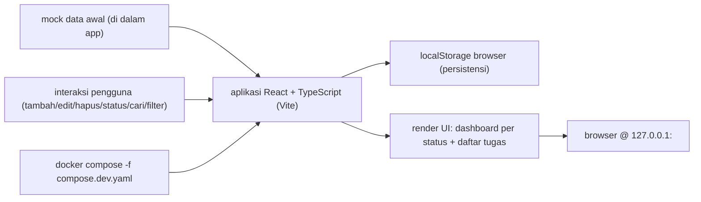

# PRD REQ-20261014-demo-task-tracker-ui v1 — Aplikasi task tracker UI (demo, React + Vite)

| Field | Nilai |
|---|---|
| REQ-ID | REQ-20261014-demo-task-tracker-ui |
| Versi | v1 |
| Plane key | DTUI-1 |
| Status | OWNER_REVIEW |
| Tanggal | 2026-10-14 00:33 WIB |
| Risk | LOW |
| Alasan risk | Aplikasi demo front-end statis: tanpa backend/API/DB, tanpa login, tanpa data sensitif (mock data lokal), dijalankan lokal di 127.0.0.1; perubahan pada repo publik + project Multica baru tetap terkendali karena hanya branch, tanpa merge/deploy. |
| Mode | DEMO (lihat §2b skill prd-workflow; maks 4 AC) |
| Versi sebelumnya | tidak ada |
| Ringkasan perubahan | tidak ada |

Catatan sumber (aturan c):
- Yang berkategori `owner` adalah kalimat-kalimat yang datang apa adanya dari brief owner (diteruskan HQ lewat task `t_07e0e88d`, disampaikan artrios atas instruksi raka, `--source artrios`, 2026-10-14 00:31 WIB).
- Isi mock data (judul tugas contoh), skema localStorage, himpunan nilai prioritas, dan port lokal adalah `usulan agent (belum disetujui owner)` — bukan instruksi owner dan bukan master plan.
- Catatan mode DEMO (prd-workflow §2b): jumlah AC dibatasi 4 sesuai brief owner; test otomatis (Vitest/RTL + Playwright) DIMINTA EKSPLISIT oleh owner, sehingga MENYIMPANG dari default DEMO ("test browser/E2E otomatis" biasanya non-goal) — lihat §10 dan C11.

---

# BAGIAN PRODUK

## 1. Overview

Masalah: belum ada aplikasi front-end nyata yang dapat dipakai untuk mendemonstrasikan alur kedua Hermes → Multica pada proyek UI baru (repo baru, project Multica baru, issue induk baru), sementara brief membutuhkan satu aplikasi task tracker kecil yang dapat dibangun, dijalankan, dan diuji secara objektif.

Tujuan: menyediakan satu aplikasi task tracker berbasis React + TypeScript + Vite (CSS responsif, penyimpanan localStorage, mock data awal) dengan dashboard ringkasan jumlah tugas per status, daftar tugas yang mendukung status To Do / In Progress / Done serta tambah / edit / hapus, pencarian, filter status & prioritas, dan perubahan status lewat UI; dapat dibangun dan dijalankan lokal lewat `docker compose -f compose.dev.yaml up -d --build` di `127.0.0.1`. Ini demo alur, bukan untuk dipublikasikan.

Ukuran sukses (terukur, minimal 1):
- UK1. Keempat acceptance criteria owner (AC1–AC4, bagian 12) lulus dengan BUKTI perintah/output, bukan klaim. Cara ukur: jalankan cek di bagian 19. Sumber data: log uji.
- UK2. Dashboard menampilkan jumlah tugas per status yang COCOK dengan isi daftar setelah SETIAP operasi (tambah/edit/hapus/ubah status/pencarian/filter), diverifikasi di uji. Cara ukur: bandingkan angka ringkasan vs jumlah kartu terlihat. Sumber data: hasil uji (unit/E2E + cek manual).
- UK3. Data bertahan setelah reload (localStorage): tambah/ubah satu tugas, reload, tugas masih ada. Cara ukur: langkah E2E/manual + inspeksi localStorage. Sumber data: log uji.

## 2. Stakeholders, users, business context

- Owner: raka — pemilik keputusan, approver satu-satunya (Telegram 5625664463) atau artrios via Hermes CLI `--source artrios`.
- Pengguna akhir aplikasi: satu pengguna tunggal (pemakai lokal) yang mengelola daftar tugasnya sendiri. Sumber: owner (brief, aplikasi task tracker pribadi tanpa login).
- Pelaksana: squad Multica (Project Manager + agent) di bawah project baru `demo-task-tracker-ui`; engineering-management TIDAK menulis kode.
- Konteks bisnis: aplikasi ini artefak DEMO alur Hermes → Multica pada proyek UI baru; data 100% mock/lokal, tanpa data perusahaan. UAT dilakukan manual oleh owner di akhir.

## 3. Requirements (persyaratan tingkat tinggi)

- REQ1. Aksesibilitas: aplikasi dapat dibuka di browser modern ponsel dan desktop; tanpa login; tata letak CSS responsif.
- REQ2. Pengguna: satu pengguna tunggal tanpa akun, tanpa peran, tanpa autentikasi.
- REQ3. Cara input/perubahan data: seluruh operasi lewat UI (form/daftar) di browser; data disimpan di localStorage browser (tanpa server).
- REQ4. Kekhususan data: mock data awal disediakan di dalam aplikasi; DILARANG memuat data perusahaan atau data pribadi nyata.
- REQ5. Notifikasi: tidak berlaku — tidak ada notifikasi/email/push.
- REQ6. Kualitas: memenuhi AC1–AC4 (bagian 12); unit test Vitest/RTL dan browser/E2E test Playwright LULUS (diminta eksplisit owner); tidak ada error console yang menghambat alur utama.
- REQ7. Tampilan: CSS responsif (desktop & mobile); dashboard ringkasan per status + daftar tugas.
- REQ8. Operasional: dapat dibangun dan dijalankan lokal dengan `docker compose -f compose.dev.yaml up -d --build`, HANYA pada `127.0.0.1`.

## 4. Core Features (MVP)

Fitur versi pertama (`tidak ada` fitur di luar daftar ini):

1. Dashboard ringkasan: jumlah tugas per status (To Do, In Progress, Done) dan total.
2. Daftar tugas dengan status To Do / In Progress / Done.
3. Tambah tugas (judul + status + prioritas minimal).
4. Edit tugas.
5. Hapus tugas (dengan konfirmasi minimal atau tanpa konfirmasi — detail teknis bebas).
6. Pencarian tugas (berdasarkan judul/teks).
7. Filter berdasarkan status dan berdasarkan prioritas.
8. Perubahan status tugas lewat UI (kontrol eksplisit, mis. tombol/dropdown — lihat OQ5).
9. Mock data awal (beberapa tugas contoh) yang dimuat saat pertama kali dibuka.
10. Persistensi ke localStorage; perubahan bertahan setelah reload.
11. CSS responsif untuk desktop dan mobile.
12. Unit test Vitest + React Testing Library; browser/E2E test Playwright (diminta eksplisit owner).
13. `compose.dev.yaml` untuk menjalankan aplikasi lokal di `127.0.0.1`.

OPSIONAL (hanya bila owner memutuskan; di luar MVP default): drag-and-drop untuk perubahan status (OQ5); tanggal jatuh tempo / deskripsi tugas (OQ6).

## 5. User Flow

- UF1. Pengguna membuka aplikasi → dashboard menampilkan jumlah per status + daftar tugas (mock data pada kunjungan pertama; data tersimpan pada kunjungan berikutnya).
- UF2. Pengguna menambah tugas → tugas muncul di daftar, dashboard ter-update, data tersimpan di localStorage.
- UF3. Pengguna mengedit tugas (judul/prioritas/status) → perubahan terlihat di daftar & dashboard, tersimpan.
- UF4. Pengguna menghapus tugas → tugas hilang dari daftar, dashboard ter-update, tersimpan.
- UF5. Pengguna mengubah status tugas (mis. To Do → In Progress) lewat kontrol UI → status & dashboard ter-update, tersimpan.
- UF6. Pengguna mencari kata kunci → daftar menyaring sesuai pencarian; dashboard konsisten dengan hasil terlihat (lihat UK2/OQ4).
- UF7. Pengguna memfilter status/prioritas → daftar menyaring sesuai filter.
- UF8. Pengguna me-reload halaman → seluruh perubahan tetap ada (localStorage).
- UF9. Pengguna membuka di layar ponsel → tata letak responsif, alur utama tetap bisa dijalankan.
- UF10. (di luar aplikasi, konteks alur) squad membangun di branch fork, menjalankan `docker compose -f compose.dev.yaml up -d --build`, menjalankan Vitest + Playwright, lalu lapor "siap review owner".

## 6. Architecture

Aliran data: mock data awal + interaksi pengguna → state aplikasi React (TypeScript) → render UI (dashboard + daftar) → persistensi localStorage di browser. Tidak ada server aplikasi, API, atau database; container hanya menyajikan aset build/dev server secara lokal.

Stack (DARI OWNER — brief eksplisit, bukan usulan agent): React, TypeScript, Vite, CSS responsif, localStorage, Vitest + React Testing Library, Playwright, Docker + Docker Compose. Mock data awal. Hindari dependency tambahan tanpa kebutuhan jelas.

## 7. Database Schema

`tidak berlaku` — tidak ada basis data. Data hidup di localStorage browser; tidak ada tabel, migrasi, atau koneksi DB.

## 8. Design & Technical Constraints

Setiap butir mencantumkan SUMBER (aturan c). Kategori: `owner`, `master plan`, `usulan agent (belum disetujui owner)`.

- C1. Stack: React, TypeScript, Vite, CSS responsif, localStorage, Vitest + React Testing Library, Playwright, Docker + Docker Compose.
  Sumber: owner — "Stack: React, TypeScript, Vite, CSS responsif, localStorage, Vitest + React Testing Library, Playwright, Docker + Docker Compose".
- C2. Gunakan mock data awal; hindari dependency tambahan tanpa kebutuhan jelas.
  Sumber: owner — "Gunakan mock data awal. Hindari dependency tambahan tanpa kebutuhan jelas."
- C3. Aplikasi front-end saja: TANPA backend, API, database, autentikasi, integrasi eksternal.
  Sumber: owner — daftar "Di luar scope".
- C4. Harus bisa dijalankan lokal dengan `docker compose -f compose.dev.yaml up -d --build`, HANYA di `127.0.0.1` (tidak pernah bind `0.0.0.0`).
  Sumber: owner — AC1; ditambah `org-operating-rules` §6 (never bind 0.0.0.0).
- C5. Data disimpan di localStorage dan bertahan setelah reload.
  Sumber: owner — AC3 + "localStorage".
- C6. Perubahan status dilakukan melalui UI.
  Sumber: owner — AC2.
- C7. Unit test Vitest/RTL dan browser/E2E test Playwright LULUS (diminta eksplisit owner).
  Sumber: owner — AC3 + "Playwright serta automated test termasuk karena diminta eksplisit".
- C8. Tidak ada error console yang menghambat alur utama.
  Sumber: owner — AC3.
- C9. CSS responsif untuk desktop dan mobile.
  Sumber: owner — "CSS responsif" + AC4 ("tampilan desktop/mobile").
- C10. Tidak memakai data perusahaan atau data pribadi nyata (mock data).
  Sumber: owner — "task tracker statis tanpa backend atau data sensitif" + `org-operating-rules` §6.
- C11. Non-goals mode DEMO (prd-workflow §2b) — backend, database, login, Lighthouse, quality gate per halaman, CI, deploy — KECUALI test otomatis (Vitest/Playwright) yang DIMINTA EKSPLISIT owner.
  Sumber: owner (test otomatis diminta) + usulan agent (penerapan default DEMO §2b).
- C12. Target repo: fork `rakarangga/demo-task-tracker-ui` dari `devmhk/demo-task-tracker-ui`. Batas keras: hanya branch; TANPA merge, TANPA deploy, TANPA kredensial produksi.
  Sumber: owner (target fork) + prosedur Multica (`multica-handoff` §1/§6, `org-operating-rules` §9).
- C13. Burn limit demo: 12 runs, 30 menit, atau permintaan perubahan kedua pada sub-issue.
  Sumber: owner — brief ("Terapkan burn limit demo: 12 runs, 30 menit, atau permintaan perubahan kedua pada sub-issue").
- C14. Port lokal aplikasi di `127.0.0.1`.
  Sumber: owner (harus di 127.0.0.1); NILAI port spesifik = usulan agent (OQ1).

## 9. Scope

Yang termasuk dalam PRD ini:
1. Aplikasi task tracker React + TypeScript + Vite (fitur bagian 4) dengan CSS responsif.
2. Dashboard ringkasan jumlah tugas per status + daftar tugas (To Do / In Progress / Done).
3. Tambah / edit / hapus tugas; pencarian; filter status & prioritas; perubahan status lewat UI.
4. Mock data awal + persistensi localStorage (bertahan setelah reload).
5. Unit test Vitest/RTL + browser/E2E test Playwright (diminta eksplisit owner).
6. `compose.dev.yaml` untuk menjalankan lokal di `127.0.0.1`.
7. Acceptance criteria AC1–AC4 (bagian 12) + bukti pengujian.
8. Repo kerja: fork `rakarangga/demo-task-tracker-ui` (hanya setelah `PRD_APPROVED` dan approval langkah Multica).

## 10. Non-goals

Secara eksplisit TIDAK dikerjakan (default mode DEMO, prd-workflow §2b):
- Backend, API, database.
- Autentikasi / login.
- Integrasi eksternal.
- Refactoring yang tidak terkait; dependency tanpa kebutuhan jelas.
- Lighthouse.
- Quality gate per halaman.
- CI.
- Deploy (aplikasi hanya dijalankan lokal).

Tambahan non-goal dari brief owner:
- Hosting/publikasi/domain/TLS.
- Multi-pengguna / kolaborasi / sinkronisasi antar perangkat.
- Data perusahaan atau data pribadi nyata (semua data mock/lokal).
- Perubahan pada repo lain, infra, atau project Multica lain.

PENGECUALIAN yang disengaja (Menyimpang dari default DEMO karena diminta eksplisit owner): unit test Vitest/RTL DAN browser/E2E test Playwright TIDAK termasuk non-goal — keduanya TERMASUK scope (C7, AC3). Sumber: owner.

## 11. Business rules

- BR1. Status tugas hanya dari himpunan {To Do, In Progress, Done}.
- BR2. Jumlah pada dashboard HARUS konsisten dengan isi daftar setelah setiap operasi (lihat UK2).
- BR3. Setiap perubahan (tambah/edit/hapus/ubah status) disimpan ke localStorage segera.
- BR4. Mock data dimuat HANYA saat belum ada data tersimpan (kunjungan pertama); data tersimpan tidak ditimpa mock.
- BR5. Tidak ada data pengguna yang dikirim ke jaringan mana pun; seluruh data tetap di browser.
- BR6. Aplikasi hanya diakses lewat `127.0.0.1`.
- BR7. Judul tugas tidak boleh kosong (validasi minimal saat tambah/edit) — usulan agent (OQ6).

## 12. Acceptance criteria (testable, bernomor)

Empat AC diambil dari daftar owner (diterjemahkan menjadi dapat diuji, dengan bukti). Mode DEMO: TEPAT 4 AC (prd-workflow §2b).

AC1. `docker compose -f compose.dev.yaml up -d --build` berhasil membangun dan menjalankan aplikasi; halaman dapat dibuka di `127.0.0.1:<port>`; port TIDAK terikat ke `0.0.0.0`.
Bukti: jalankan perintah (exit code 0), `docker compose ps` menunjukkan service berjalan, dan cek bind port (`ss -tlnp` / `docker ps` port mapping) hanya pada `127.0.0.1`.

AC2. Dashboard merangkum jumlah tugas per status; daftar tugas mendukung To Do / In Progress / Done serta tambah / edit / hapus, pencarian, filter status & prioritas, dan perubahan status melalui UI.
Bukti: inspeksi UI/DOM + langkah uji yang menunjukkan tiap operasi mengubah daftar DAN angka ringkasan secara konsisten.

AC3. Mock data awal tersedia; perubahan tersimpan di localStorage dan bertahan setelah reload; unit test Vitest/RTL dan browser/E2E test Playwright lulus; tidak ada error console yang menghambat alur utama.
Bukti: log test Vitest + Playwright (semua lulus), verifikasi data di localStorage setelah reload, dan tangkapan konsol browser (tanpa error yang menghambat alur utama).

AC4. Raka memeriksa fungsi utama dan tampilan desktop/mobile saat UAT lokal.
Bukti: catatan/hasil UAT manual owner (fungsi utama berjalan; tampilan desktop & mobile layak).

## 13. Assumptions

- A1. Mock data awal: beberapa tugas contoh dengan judul, status, dan prioritas (isi dikarang agent sebagai mock; OQ2).
- A2. Himpunan prioritas: mis. {Low, Medium, High} (OQ4).
- A3. Skema localStorage: satu key (mis. `task-tracker.tasks.v1`) berisi array tugas (OQ3).
- A4. Perubahan status lewat kontrol eksplisit (tombol/dropdown), TANPA drag-and-drop (OQ5).
- A5. Port lokal `docker compose`: `8080` dipublikasikan di `127.0.0.1` (dapat diubah bila bentrok; OQ1).
- A6. Judul tugas wajib tidak kosong (validasi minimal); tanpa field tambahan (deskripsi/tanggal jatuh tempo) di MVP (OQ6).
- A7. Pencarian menyaring DAFTAR; angka dashboard merangkum seluruh data tersimpan (bukan hasil filter) kecuali owner memutuskan lain (OQ7).
- A8. Pada stage implementasi, PM menjalankan skill `repo-access` (langkah pertama) dan (project baru) scaffold; fork `rakarangga/demo-task-tracker-ui` dibuat/disiapkan pada tahap itu, bukan oleh PRD ini.
- A9. Pengujian cukup lokal; tidak ada tuntutan deploy.

## 14. Open questions

TIDAK ada butir [BLOCKING]: PRD dapat dinilai dan dibangun dengan asumsi tercatat (A1–A9). Semua butir di bawah [NON-BLOCKING] dan diikuti asumsi terkait; owner dapat mengoreksi pada putaran review/approval versi ini.

- OQ1 [NON-BLOCKING] Port lokal `docker compose`: usulan 8080 di 127.0.0.1 (A5). Dampak bila salah: hanya angka port di compose.
- OQ2 [NON-BLOCKING] Isi mock data awal (judul/prioritas contoh) dikarang agent (A1). Owner dapat meminta penggantian sebelum approve.
- OQ3 [NON-BLOCKING] Skema/key localStorage (A3). Usulan: satu key berversi.
- OQ4 [NON-BLOCKING] Himpunan nilai prioritas (A2): {Low, Medium, High} atau lain?
- OQ5 [NON-BLOCKING] Perubahan status: kontrol eksplisit (tombol/dropdown, A4) atau perlu drag-and-drop? Drag-and-drop = PENAMBAHAN SCOPE → PRD v2 + kembali ke OWNER_REVIEW.
- OQ6 [NON-BLOCKING] Field tugas: cukup judul + status + prioritas (A6), atau perlu deskripsi/tanggal jatuh tempo? Tambahan field = penambahan scope → PRD v2.
- OQ7 [NON-BLOCKING] Apakah dashboard merangkum SELURUH data tersimpan atau hanya hasil pencarian/filter saat itu (A7)? Usulan: seluruh data tersimpan.
- OQ8 [NON-BLOCKING] Sumber permintaan deploy key fork/source (pola sama seperti REQ-20261013-portofolio-landing): bila nanti diperlukan, diminta lewat owner di GitHub UI; bukan wewenang engineering-management. Bukan penghalang PRD.

## 15. Dependencies

- D1. Approval owner untuk PRD v1 (gate 1) — belum ada; PRD ini belum disetujui.
- D2. Approval owner untuk LANGKAH MULTICA (gate 2) — belum ada. `handoff.md` hanya ditulis setelah `PRD_APPROVED`.
- D3. Fork `rakarangga/demo-task-tracker-ui` dari `devmhk/demo-task-tracker-ui` siap + akses squad (dibuat/disiapkan via skill `repo-access`; BUKAN oleh PRD ini). Deploy key (bila perlu) diminta lewat owner di GitHub UI (OQ8).
- D4. Project Multica BARU `demo-task-tracker-ui` + squad Project Manager tersedia (issue induk baru).
- D5. Mock data + asumsi A1–A9 diterima owner (bersamaan dengan approval PRD).

## 16. Risks & level risiko

Level risiko keseluruhan: LOW (aplikasi front-end demo non-sensitif; tanpa auth/DB/finance/deploy; hanya lokal + branch).

- R1 (LOW): angka dashboard tidak konsisten dengan daftar (bug umum pada ringkasan turunan). Mitigasi: BR2 + UK2 + AC2 diuji setelah setiap operasi.
- R2 (LOW): mock data menimpa data pengguna setelah reload. Mitigasi: BR4 (mock hanya saat belum ada data tersimpan).
- R3 (LOW): port lokal terikat ke `0.0.0.0`. Mitigasi: C4 + AC1 (bind `127.0.0.1`).
- R4 (LOW): test Playwright rapuh (flaky) sehingga menghambat "lulus". Mitigasi: selector stabil + alur uji singkat; burn limit demo C13.
- R5 (LOW): scope melebar (drag-and-drop, deskripsi, tanggal jatuh tempo). Mitigasi: Non-goals bagian 10 + OQ5/OQ6 mengikat; penambahan scope → PRD v2 + return ke OWNER_REVIEW.
- R6 (LOW): dependency tambahan menyimpang dari brief. Mitigasi: C2 (hindari dependency tanpa kebutuhan jelas).
- R7 (LOW): fork/akses repo belum siap menghambat handoff. Mitigasi: D3, langkah pertama PM `repo-access`; bukan penghalang PRD.

## 17. Data & security considerations (tanpa secret)

- Tidak ada data pengguna dikirim ke jaringan; seluruh data tetap di localStorage browser (BR5).
- Tidak ada rahasia (token/kredensial) di aplikasi, repo, atau log.
- Tidak ada endpoint/API/email keluar.
- Kontainer/port hanya di `127.0.0.1`; tidak bind `0.0.0.0` (`org-operating-rules` §6).
- Data 100% mock/lokal: tidak boleh memuat data perusahaan/pribadi nyata (C10).

## 18. Target repo & permissions yang dibutuhkan

- Repo sumber: `devmhk/demo-task-tracker-ui`.
- Fork target kerja squad: `rakarangga/demo-task-tracker-ui`.
- Project Multica: `demo-task-tracker-ui` (project BARU; issue induk BARU).
- Plane key: DTUI-1.
- Izin yang diminta (setelah `PRD_APPROVED` + approval langkah Multica): buat/ubah berkas di dalam fork pada BRANCH saja.
- BATAS KERAS: tanpa merge, tanpa deploy, tanpa kredensial produksi, tanpa menyentuh repo/infra/project lain. PRD ini sendiri tidak membuat branch/repo/project/issue Multica.
- Deploy key fork/source (bila diperlukan pada tahap implementasi): diminta lewat owner di GitHub UI (pola sama seperti REQ-20261013-portofolio-landing); bukan wewenang engineering-management (OQ8).

## 19. Definition of done & isi handoff

Definition of done (tahap implementasi, SETELAH kedua approval):
- AC1–AC4 lulus dengan bukti perintah/output (bukan klaim).
- `docker compose -f compose.dev.yaml up -d --build` menjalankan aplikasi lokal di `127.0.0.1`; build lulus tanpa error.
- Dashboard konsisten dengan daftar setelah setiap operasi; tambah/edit/hapus, pencarian, filter status & prioritas, dan perubahan status lewat UI berjalan.
- Mock data tersedia; perubahan bertahan setelah reload (localStorage).
- Unit test Vitest/RTL lulus DAN browser/E2E test Playwright lulus; tidak ada error console yang menghambat alur utama.
- Diserahkan sebagai laporan "siap review owner" dengan bukti uji; tanpa merge/deploy.
- UAT manual owner (fungsi utama + tampilan desktop/mobile) selesai.

Yang masuk paket handoff (`handoff.md`, hanya setelah `PRD_APPROVED`):
1. REQ-ID + tautan ke PRD v(N) yang disetujui.
2. Versi PRD, approver, timestamp.
3. Target repo/fork + izin (branch saja).
4. Mode (DEMO), Risk, scope, non-goals, AC, risiko, dependencies.
5. Cek/tes yang harus dijalankan + kriteria selesai.
6. Batas: branch saja, tanpa merge/deploy/kredensial produksi.
7. Apa yang harus dikembalikan + siapa reviewer berikutnya (owner).

---

## Perubahan vs versi sebelumnya

tidak ada (ini PRD v1).
